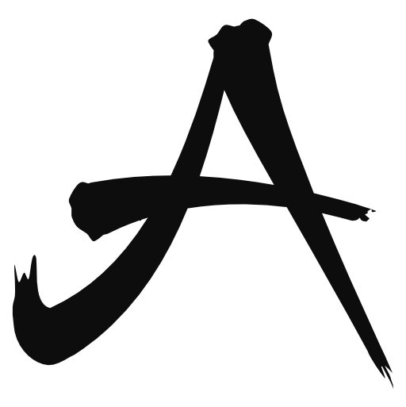

<p align="center">
  <picture>
    <source media="(prefers-color-scheme: dark)" srcset="https://raw.githubusercontent.com/allemaar/open-skills/main/assets/allemaar-icon-ondark.png" />
    <source media="(prefers-color-scheme: light)" srcset="https://raw.githubusercontent.com/allemaar/open-skills/main/assets/allemaar-icon-onlight.png" />
    
  </picture>
</p>

<p align="center">
  <strong>open-skills</strong><br />
  The skills I use with AI agents for planning, coding, review and writing.<br />
  All 90 are readable Markdown; 54 also carry a declarative <strong>YON (YounndAI Object Notation™)</strong> protocol.<br />
  <em>Read before you trust.</em>
</p>

<p align="center">
  <a href="#start-with-the-work">Start</a> · <a href="#how-i-use-them">How I use them</a> · <a href="#install">Install</a> · <a href="docs/README.md">Guides</a> · <a href="SKILLS.md">Catalog</a> · <a href="#updating">Update</a> · <a href="CHANGELOG.md">Changelog</a> · <a href="https://github.com/allemaar/open-skills/discussions">Discussions</a> · <a href="LICENSE">Apache 2.0</a>
</p>

<p align="center">
  <a href="https://github.com/allemaar/open-skills/actions/workflows/conformance.yml"></a>
  <a href="LICENSE"></a>
  <a href="https://github.com/YounndAI/yon"></a>
</p>


---

<a id="why-this-exists"></a>

## Why I keep this collection

I use Claude Code, Codex and other agents for work that takes more than one good prompt: understanding a codebase, deciding what to build, checking what changed, writing something another person can use. These skills are the instructions I keep for that work.

Some have been in daily use and evolution for well over a year; others are recent additions. That is my account of using them, not a benchmark. I publish the working set so you can read it, try the parts that fit your work, and change them for your own needs.

You do not need the whole collection. Start with one task and one skill. Read its instructions and prerequisites before giving it access to your files. A skill is still instructions to an agent; your runtime, permissions and judgment determine what it can actually do.

## Start with the work

| What you want to do | Where I would start | What to expect |
|---|---|---|
| Turn a rough idea into a useful brief | [ask-me](docs/skills/ask-me.md) | Questions about the choices that matter, with settled decisions kept separate from gaps |
| Find out what the code actually does | [investigate](docs/skills/investigate.md) | A read-only account of files, usages, dependencies and constraints |
| Try uncertain behavior in something runnable | [build-prototype](docs/skills/build-prototype.md) | A small experiment, observed results and remaining limits |
| Reproduce and diagnose a software failure | [debug-task](docs/skills/debug-task.md) | Evidence from bounded probes; a repair only within the authorized scope |
| Turn a discussion into agreed behavior | [write-spec](docs/skills/write-spec.md) | A specification with acceptance, exclusions and open decisions |
| Plan an implementation | [plan-create](docs/skills/plan-create.md) | Concrete phases, dependencies and verification gates |
| Review the actual work | [cold-review](docs/skills/cold-review.md) | Fresh review where supported, findings tied to evidence and stated coverage |
| Make a long answer easier to use | [synthesize](docs/skills/synthesize.md) | A response shaped around the reader's task, preserving facts and caveats |
| Agree on the meaning of domain terms | [define-terms](docs/skills/define-terms.md) | Definitions within their actual context, with proposed changes kept visible |
| Learn something through explanation and practice | [teach-topic](docs/skills/teach-topic.md) | A useful next step, an exercise and feedback without a claim of mastery |
| Create or improve a reusable skill | [skill-smith](docs/skills/skill-smith.md) | A scoped authoring route or a read-only assessment |
| Coordinate agents through a shared folder | [agent-mailbox](docs/skills/agent-mailbox.md) | Messages, durable dispositions and explicit continuity limits |

This table describes the **3.0.0** source. Check the [published releases](https://github.com/allemaar/open-skills/releases) for a frozen version and read the [upgrade notes](#current-source-and-releases) before updating.

The [full catalog](SKILLS.md) groups all skills by family. The [guides](docs/README.md) explain when each skill is useful, when to avoid it, what to ask and what it returns. Inside an agent, /skills-help reads its bundled taxonomy and the skills installed beside it. It leaves unknown third-party skills visible under Unclassified.

Commands in these docs use the skill's folder name, such as /insight-explore or /plan-phases. Shorter phrases in its frontmatter, such as /explore, are recognition aliases that some runtimes honor. Copying a folder and having a runtime discover it are separate things.

<a id="two-headliner-families"></a>

<a id="orientation"></a>

## How I use them

<a id="build-a-skill-or-a-library"></a>

### Create a skill or give a library its own home

If you want to create a skill, or check whether an existing one still holds up, [Skill Smith](docs/skills/skill-smith.md) is where I would start. It routes creation, assessment, consolidation, diagnosis and updates to the relevant procedure and checks. Assessment stays read-only by default; changes keep their selected scope and safeguards.

When related skills need their own library, [Skill Library Creator](docs/skills/skill-library-creator.md) provides a family manager, guided setup, templates and installation tools. The generated manager works without the creator at runtime. It previews selected locations and preserves customizations during reviewed upgrades; a verified link still does not prove runtime discovery.

<a id="choose-an-insight-method-for-the-question"></a>

### Work out the question before choosing a method

I keep several insight skills because the questions differ. Exploring alternatives, checking a decision and investigating a failure need different work.

| The question | Skill |
|---|---|
| What approaches could we take? | [insight-explore](docs/skills/insight-explore.md) |
| What frame or connection are we missing? | [insight-angles](docs/skills/insight-angles.md) |
| What is weak in this concrete output? | [insight-critique](docs/skills/insight-critique.md) |
| How could this plan fail? | [insight-premortem](docs/skills/insight-premortem.md) |
| Why did this problem happen? | [insight-root-cause](docs/skills/insight-root-cause.md) |
| What happened in comparable completed cases? | [insight-reference-class](docs/skills/insight-reference-class.md) |
| What would test this assumption? | [insight-test-assumption](docs/skills/insight-test-assumption.md) |
| Is more research worth the time and cost? | [insight-value-of-information](docs/skills/insight-value-of-information.md) |

For a decision that needs several methods, [insight-cross-examine](docs/skills/insight-cross-examine.md) selects the useful depth, reuses applicable findings and returns a recommendation with its weak assumption. Missing evidence can justify deferring a choice. More options do not fill an evidence gap.

<a id="worked-example-cold-review"></a>

### Keep planning, execution and checking distinct

A request might start like this:

~~~text
/investigate Trace how this upload reaches storage. Read only; show the call path and gaps.
/plan-create Plan the agreed change, with concrete steps and checks for the failure cases.
~~~

These are separate requests, not a chain that runs itself. Once a concrete plan is approved, [plan-execute](docs/skills/plan-execute.md) follows that plan and stops on unspecified judgments or drift. A ticket or specification alone is not approval of an executable plan.

I keep [verify](docs/skills/verify.md) for the formal check against intent and execution, with the plan when available. Without a plan it can still check evidence, but cannot return a clean synchronization verdict. [cold-review](docs/skills/cold-review.md) brings an outside view to the actual artifacts. [double-check](docs/skills/double-check.md) is the smaller request when one claim needs another look.

For example:

~~~text
/cold-review Review this auth refactor against the agreed behavior and repository standards. Identify the candidate you inspected and what you could not check.
~~~

Review findings still need checking against the source. A good report, a valid protocol and a passing test each provide different evidence.

<a id="human-output"></a>

### Give the writing the same care as the work

I want to understand the result without reconstructing the whole conversation. [human-output](docs/skills/human-output.md) puts the decision, practical consequence, evidence and unchecked scope where a reader can find them. [human-rewrite](docs/skills/human-rewrite.md) repairs an existing text while preserving its meaning; [human-merge](docs/skills/human-merge.md) reconciles several reports; [human-draw](docs/skills/human-draw.md) gives relationships a small text figure when that helps.

[synthesize](docs/skills/synthesize.md) chooses a response shape for the reader's need. A simple answer can stay simple. [prose-audit](docs/skills/prose-audit.md) is useful when I want a diagnosis of repetition or avoidable reading load before rewriting.

~~~text
/synthesize Turn these findings into a decision brief. Keep the source disagreements, uncertainty and conditions that could change the recommendation.
~~~

The [write-copy](docs/skills/write-copy.md) family handles promotional writing. Its current event-video specialization drafts copy and a separate voiceover handoff; it does not generate media or publish.

<a id="agent-mailbox"></a>

<a id="run-bounded-work-and-write-for-the-reader"></a>

### Keep a record when several agents are involved

I use [agent-mailbox](skills/agent-mailbox/) in FULL mode when I want a traceable orchestration record between agents. Claude Code and Codex agents can exchange append-only Markdown messages through folders I control, including local folders, OneDrive, free **Lyt (Link Your Think™)** vaults and network shares.

~~~text
shared folder -> request -> durable disposition -> deliverable
~~~

I keep exclusive claims provisional until the declared writer or Handler grants the exact scope and lease. FULL keeps its session, handshake, claim and rollup mechanics; frozen membership or recipient snapshots, quorum decisions and built-in authentication are not available in this version.

This describes my current use. It does not promise that every host can wake a stopped task or that every synchronization provider has the same latency. Work-or-Listen is local to each participant. Publishing a message, seeing it locally, detecting it, waking a task and recording its disposition are separate observations.

Start with the [skill](skills/agent-mailbox/SKILL.md). Its [resource spine](skills/agent-mailbox/resources/INDEX.md) routes collaboration recipes; [connection guides](skills/agent-mailbox/references/CONNECTION-GUIDES.md) cover adapters; [validation record](skills/agent-mailbox/references/VALIDATION.md) distinguishes observed, design-validated and pending evidence. No watcher, daemon, SDK or runtime dependency is shipped.

The [headless guides](docs/README.md#orchestration--dispatch) cover bounded Claude Code, Codex, Antigravity and Grok CLI work, model selection and usage checks. Provider authentication, limits, permissions and supervision still apply.

### Find my way back into a project or folder

The orientation skills answer a few recurring questions from current artifacts: [status](docs/skills/orient-status.md), [what changed](docs/skills/orient-map.md), [what is stuck](docs/skills/orient-gaps.md), and [what comes next](docs/skills/orient-roadmap.md). Their estimates and gaps should remain visible. When topology is unknown, I keep the evidenced changes and nodes visible without assuming a trunk or branch.

<a id="map-your-knowledge"></a>

For organizing Markdown, [Map Your Knowledge](MapYourKnowledge.md) starts from the scope's existing conventions. [map-this](docs/skills/map-this.md) returns a zero-write assessment and proposals before selected changes. [map-check](docs/skills/map-check.md) reports only the checks it actually covers, refuses malformed contracts or unreadable required evidence, and [map-maintain](docs/skills/map-maintain.md) runs one selected repair-and-recheck cycle. [map-init](docs/skills/map-init.md) can install a route in selected existing directive files after exact-diff approval.

## Try a workflow

Some useful tasks need a recipe rather than another installed skill. The [workflow index](docs/workflows/README.md) gives prerequisites, a request to try, expected output and limits.

- [Prepare an expert questionnaire](docs/workflows/prepare-an-expert-questionnaire.md) when someone else holds the information you need.
- [Describe a recurring workflow](docs/workflows/describe-a-workflow.md) before deciding whether to automate it.
- [Co-write a document](docs/workflows/co-write-a-document.md) while preserving sources and intervening edits.
- [Make a test-driven change](docs/workflows/test-driven-change.md) from an independent behavioral expectation.
- [Enforce module boundaries](docs/workflows/enforce-module-boundaries.md) with allowed and forbidden controls.
- [Write PR evidence](docs/workflows/write-pr-evidence.md) that matches the selected change and actual checks.
- [Create a small skill](docs/workflows/create-a-small-skill.md) or [a portable library](docs/workflows/create-a-portable-library.md) when the repeated work warrants it.

The library creator supplies a family manager, templates and deliberate installation scope. It does not configure sharing or cloud sync. Installing or publishing what you create remains a separate action.

<a id="what-is-inspectable-and-what-is-not-enforced"></a>

## What you can inspect

Read the complete skill folder, including the references and helpers its selected route requires. Check required sibling skills before choosing an install set. Optional siblings and repository release tooling have different roles; the skill's source states which are needed.

| Surface | What it tells you |
|---|---|
| SKILL.md | The instructions the agent is being asked to follow |
| protocol.yon, where supplied | An inspectable declaration of steps, rules and gates |
| Parser validation | Whether the declaration is structurally valid for its profile |
| CI checks | The specific syntax, references, dataflow, catalogs, counts and privacy properties those checks inspect |

There is no interpreter forcing the model to obey a protocol. A structurally valid protocol can still describe harmful behavior. Validation does not sandbox an agent or replace reading the instructions.

Validate a protocol yourself with the separately published Apache-2.0 reference parser created by Alexandru Mares:

```bash
npx -y @younndai/yon-parser@2 validate \
  skills/cold-review/protocol.yon --profile exec
```

The `npx` command may download and execute that package. Inspect the package or install it through a route you trust before relying on it. The exact trust boundaries, including what validation cannot establish, are in [`THREAT-MODEL.md`](THREAT-MODEL.md); current structural results are in [`CONFORMANCE.md`](CONFORMANCE.md).

## Install

The skills are instructions for a compatible agent runtime; a protocol is not an executable runtime or sandbox. Read the selected guide for required tools and companions. The bundled installer needs Node.js.
Node 20 is the CI baseline.
 Its default validation also needs npm/npx and may fetch the public parser. A headless workflow additionally needs its named provider CLI, a working login and the bounded supervision described in that skill. No provider account or subagent is required for the whole collection: those requirements belong to the selected route.

The safest first path is a frozen copy: read the source, copy only the skills you want, and diff before updating.

```bash
git clone https://github.com/allemaar/open-skills
cd open-skills

# POSIX shell. Set exactly one directory your runtime actually reads.
# The subshell keeps a failed preflight from closing an interactive terminal.
(
  set -eu
  SKILLS_DIR="$HOME/.claude/skills"
  SRC="skills/cold-review"
  DEST="$SKILLS_DIR/cold-review"

  probe="$DEST"
  while [ "$probe" != "/" ]; do
    [ ! -L "$probe" ] || { echo "link in destination chain: $probe"; exit 1; }
    probe=$(dirname "$probe")
  done
  [ ! -e "$DEST" ] || { echo "already installed — diff before replacing"; exit 1; }
  cp -r "$SRC" "$DEST"
)
```

The directories are not interchangeable. Claude Code reads `~/.claude/skills`; current Codex installations can use `~/.agents/skills`; other tools may use their own directory. Establish the path your runtime reads and change `SKILLS_DIR` once. On Windows, prefer the installer below: it performs native link checks instead of relying on POSIX shell semantics.

### Optional installer

[`install.mjs`](install.mjs) is one readable Node file with zero local npm dependencies. It copies skill folders, can stamp their `SKILL.md` with an unsigned provenance note, and invokes `npx` for protocol validation unless you pass `--no-validate`.

```bash
node install.mjs cold-review
node install.mjs --runtime claude cold-review
node install.mjs --all
node install.mjs --list
```

Important boundaries:

- By default it targets every known skills directory that already exists. Use `--runtime claude|codex|agents` to narrow it.
- It refuses to overwrite an existing skill unless you pass `--force`.
- It refuses to overwrite a symlinked or junctioned skill rather than risk deleting through the link into its source.
- With `--force`, it stages and, unless `--no-validate` is supplied, validates the candidate before moving the existing copy aside, restores that copy if the swap fails, and surfaces crash leftovers for manual inspection.
- Its provenance stamp is an unsigned plain-text assertion, not a certificate, and makes the installed `SKILL.md` differ from this repository. `--no-stamp` preserves byte identity.
- The installer itself uses Node built-ins; validation may still fetch and execute `@younndai/yon-parser` through `npx`.

### Claude Code plugin

```text
/plugin marketplace add allemaar/open-skills
/plugin install open-skills@open-skills
```

This is the fastest Claude Code route, but it reverses the read-first order: installation happens before you inspect every skill. Use it only if that trade is acceptable.

Other distribution tools may also consume the repository, including `gh skill install allemaar/open-skills`. Their provenance metadata and update behavior belong to those tools. Review their prompts and resulting files rather than treating a source label as authenticated provenance.

**Telemetry:** the skills themselves contain no telemetry. The installer performs no analytics or reporting; its only optional network execution is parser validation through `npx`. Your agent runtime, plugin manager, package manager, Git host, or referenced external tool may have its own telemetry.

<a id="unreleased-additions"></a>

<a id="new-in-200"></a>

<a id="new-in-170"></a>

## Current source and releases

The **3.0.0** source adds ask-me, build-prototype, debug-task, write-spec, define-terms and teach-topic, plus the workflow recipes linked above. Every skill has a [guide](docs/README.md). I use the smaller capabilities independently; interviews, saved records, prototypes and implementation are separate choices.

Before upgrading from 2.x, read the [3.0.0 migration notes](CHANGELOG.md). Exclusive mailbox work now waits for an exact causal grant. Orientation consumers must preserve absent topology as unknown. Diff-recap stops on rename/copy input instead of squeezing it into a single-path record. Existing skill names remain; no skill is removed in this release. Check the [release page](https://github.com/allemaar/open-skills/releases) for publication status.

The 2.0.0 release introduced the skill guides, the Skill Smith authoring routes and the portable library creator, along with the focused insight methods. Skill Smith replaces the retired skills-audit and new-skill-creator entrypoints. Preserve local customizations and update explicit references before removing old copies. Install the complete Skill Smith folder; library setup remains with the library creator and publication is separate.

[Design scope](docs/design-scope.md) explains larger capabilities that are still deferred. This README describes available work and its limits; planned capabilities are not installed ones.

## Updating

A copied skill is intentionally frozen. To update it, pull the repository, diff the installed folder against the candidate, read the change, then re-copy only after accepting it.

```bash
git pull
git diff --no-index ~/.claude/skills/cold-review skills/cold-review
```

Silence means byte-identical. Do not filter the diff unless you deliberately installed with the provenance stamp and understand exactly which lines you are excluding. A symlink is different: it makes every pull a live update, often without a separate review moment. That is useful while authoring your own skills and a poor default for running somebody else's.

Before updating, read [`CHANGELOG.md`](CHANGELOG.md). Skill folders can be renamed, references can change, and a new release can alter the trust surface even when the syntax remains valid.

## For agents and tooling

The generated [human catalog](SKILLS.md), [YON catalog](catalog.yon), [JSON catalog](catalog.json), [discovery manifest](llms.txt) and [recommendation graph](skills.graph.yon) come from live skill metadata, protocol facts and the pack taxonomy. Their owner is [tools/spine.mjs](tools/spine.mjs). These surfaces help discovery; they do not enforce runtime behavior.

## YON and its parser

Alexandru Mares created YON and its Apache-2.0 reference parser. They are published separately in the YounndAI ecosystem, alongside the public [specification](https://github.com/YounndAI/yon-spec), [parser](https://www.npmjs.com/package/@younndai/yon-parser), and editor support ([VS Code Marketplace](https://marketplace.visualstudio.com/items?itemName=YounndAI.yon) · [Open VSX](https://open-vsx.org/extension/YounndAI/yon)).

[`yon-read`](skills/yon-read/) interprets existing YON. [`yon-write`](skills/yon-write/) authors it. Their presence in this personal pack does not transfer ownership of YON to open-skills or make open-skills a YounndAI product.

## Contributing and support

If you try a skill and find an unclear step or a failure case, a concrete example is useful. Keep private material out of it. Read [CONTRIBUTING.md](CONTRIBUTING.md) before a pull request: commits require DCO sign-off, skill metadata must stay complete, and public content must contain no personal paths, credentials, mailbox identifiers or private operational evidence.

- Questions and examples: [GitHub Discussions](https://github.com/allemaar/open-skills/discussions)
- Bugs and feature requests: [GitHub Issues](https://github.com/allemaar/open-skills/issues)
- Vulnerabilities: [SECURITY.md](SECURITY.md), never a public issue for a live report

## License and project identity

Copyright 2026 Alexandru Mares (allemaar.com).

open-skills is licensed under the [Apache License, Version 2.0](LICENSE). See [`NOTICE`](NOTICE) for attribution and [`TRADEMARK.md`](TRADEMARK.md) for the separate trademark rules.

This is my personal project, separate from the YounndAI product portfolio. **YounndAI™**, **YounndAI Object Notation™**, and **Link Your Think™** are trademarks of MARLINK TRADING SRL. Their truthful mention here does not imply that open-skills is a YounndAI product.

---

Made by [Alexandru Mares](https://allemaar.com).
